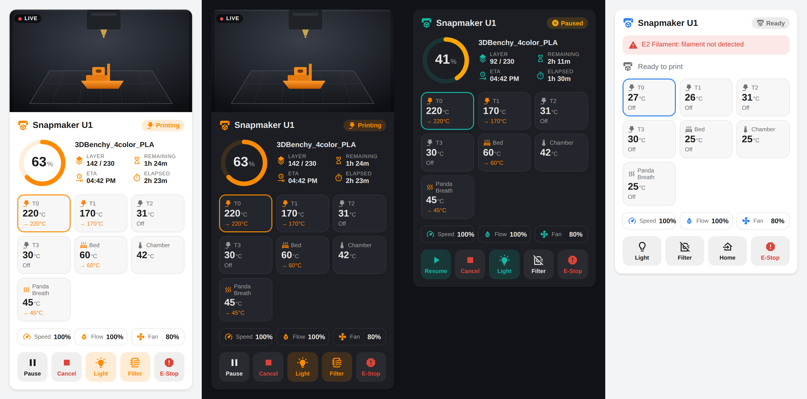
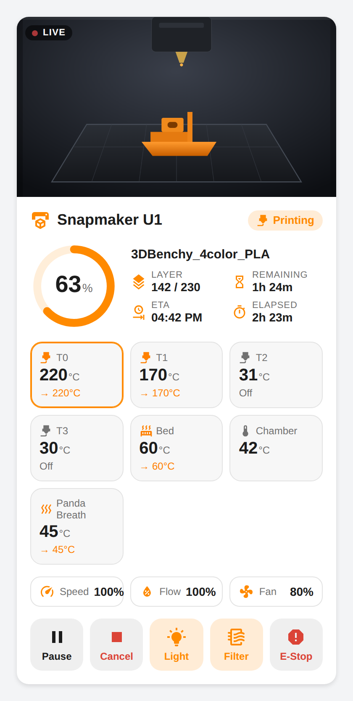
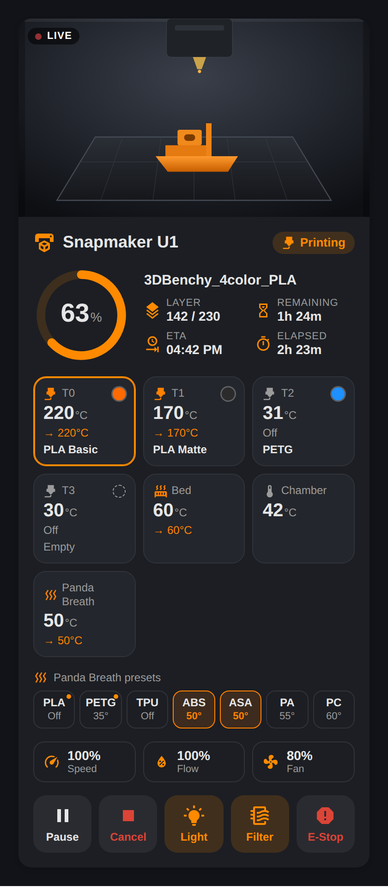
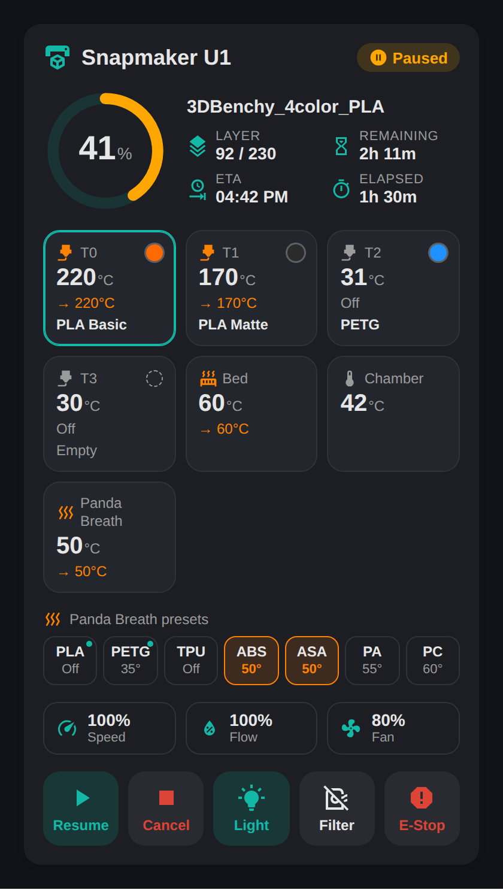
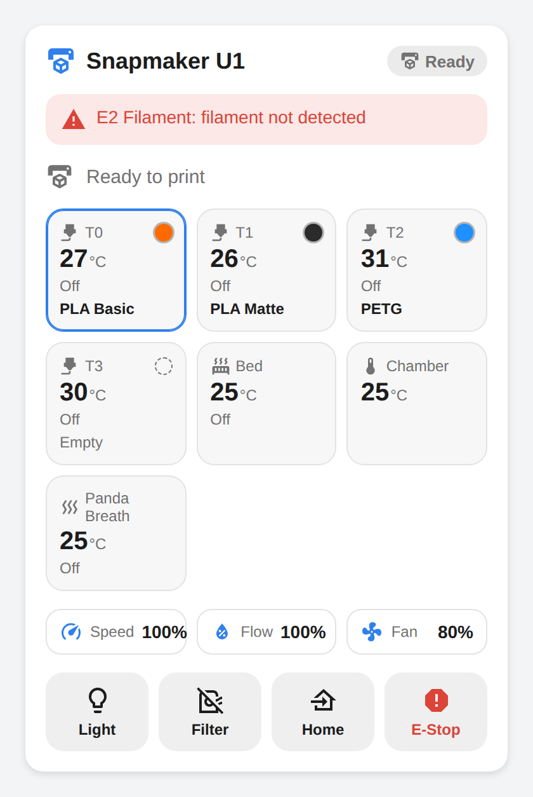

# ha-snapmaker-u1

> A Home Assistant custom integration for the **Snapmaker U1** 3D printer,
> inspired by [ha-bambulab](https://github.com/greghesp/ha-bambulab).
> Live status, temperatures, camera, print controls, BIQU Panda Breath
> support and a built-in dashboard card. No cloud needed.



<sub>Mockups of the bundled dashboard card rendered with sample data. Your card
shows your printer's real camera and values.</sub>

## Contents

- [How it works](#how-it-works)
- [Features](#features)
- [Dashboard card](#dashboard-card)
- [Panda Breath / DragonBreath chamber heater](#panda-breath--dragonbreath-chamber-heater)
- [Installation](#installation)
- [Configuration](#configuration)
- [Authentication](#authentication)
- [Automations](#automations)
- [Troubleshooting](#troubleshooting)
- [Technical notes](#technical-notes)

---

## How it works

The Snapmaker U1 runs a modified **Klipper** firmware with a modified **Moonraker**
API server. This integration connects directly to that API over your local network
using:

- **WebSocket** (JSON-RPC 2.0) at `ws://<printer-ip>/websocket` for real-time
  push updates (no polling delay).
- **HTTP REST** at `http://<printer-ip>/` as a fallback and for sending commands.

No Snapmaker account or cloud connection is required. The integration does
**not** include its own Moonraker; it talks to the one running on the printer.

---

## Features

### Sensors
| Entity | Description |
|---|---|
| Print State | `standby` / `printing` / `paused` / `complete` / `error` / `cancelled` |
| Print Progress | Percentage complete |
| Current Layer / Total Layers | Layer counter for the current print |
| Print Duration | Active printing time (excludes pauses) |
| Total Duration | Time since the print started (includes pauses) |
| Time Remaining | Estimated time left |
| Print ETA | Estimated finish time (timestamp) |
| Filament Used | Millimetres of filament consumed |
| Filename | Name of the file being printed |
| Bed Temperature / Bed Target | Heated-bed current and target temperature |
| T0–T3 Nozzle Temperature / Target | Per-nozzle current and target temperature (auto-detects up to 4) |
| Chamber / extra temperature sensors | Every Klipper `temperature_sensor` (e.g. chamber, MCU) |
| Panda Breath Temperature | Chamber heater temperature, if present ([details](#panda-breath--dragonbreath-chamber-heater)) |
| Part Cooling Fan | Fan speed in % |
| Print Speed / Flow Rate | Current speed and flow overrides in % |
| Klipper State | `ready` / `startup` / `shutdown` / `error` |
| Toolhead Position | X/Y/Z coordinates (with individual attributes) |

### Binary sensors
| Entity | Description |
|---|---|
| Printer Ready | On when Klipper reports `ready` |
| Printing | On while a print is running |
| Paused | On while a print is paused |
| Error | On when a Klipper/print error is active (message in attributes) |
| Filament runout | One per filament sensor; on when filament is **not** detected |

### Buttons
| Button | Action |
|---|---|
| Pause Print / Resume Print / Cancel Print | Control the active print |
| Emergency Stop | Immediately halts all motion |
| Home All Axes | `G28` |
| Home X / Y / Z | Home a single axis |
| Restart Klipper | Restarts the Klipper process |

### Controls (numbers, selects, switches)
| Entity | Description |
|---|---|
| Bed Target Temperature | Set the bed temperature (0–120 °C) |
| T0–T3 Target Temperature | Set each nozzle temperature (0–300 °C) |
| Part Cooling Fan Speed | 0–100 % |
| Print Speed Override / Flow Rate Override | `M220` / `M221` |
| Panda Breath Target | Chamber heater target; `0` turns it off, otherwise between its min and max (e.g. 15–70 °C) |
| Print File | Pick a file from the printer and start printing it |
| Active Tool | Switch between T0–T3 |
| Work Light | The cavity light (reads its real state from the printer) |
| DragonBreath Filter | Chamber filter fan, if present |

### Camera
- **Webcam**: camera URLs are discovered from Moonraker (`/server/webcams/list`),
  falling back to `/webcam/snapshot.jpg` and `/webcam/stream.mjpg`.
- If the snapshot endpoint fails, a frame is taken from the MJPEG stream
  instead. That also wakes a stock U1 camera that has gone idle.
- The live view proxies the printer's MJPEG stream directly.
- The URLs in use are shown as `snapshot_url` / `stream_url` attributes on
  the camera entity.

> **Note:** The camera is served by the **printer**, not by Home Assistant.
> Test camera URLs against the printer's IP, e.g.
> `http://<printer-ip>/webcam/snapshot.jpg`, not your Home Assistant address.

### Services
| Service | Description |
|---|---|
| `snapmaker_u1.execute_gcode` | Send any G-code command or macro |
| `snapmaker_u1.set_bed_temperature` | Set heated-bed target (°C) |
| `snapmaker_u1.set_nozzle_temperature` | Set a nozzle target (°C) by extruder index |
| `snapmaker_u1.start_print` | Start a file that is already on the printer |

All services take the printer's `config_entry_id`.

### Diagnostics
**Settings → Devices & Services → Snapmaker U1 → ⋮ → Download diagnostics**
gives you the printer state, connection status and camera URLs. Your API key
is redacted automatically.

---

## Dashboard card

The integration ships its own dashboard card, styled like the
[Printer Tools](https://github.com/62fixolab/Printer-Tools-App) app. It loads
automatically, so there's nothing extra to install or add as a resource.

**Edit dashboard → Add card → search "Snapmaker U1"**, or in YAML:

```yaml
type: custom:snapmaker-u1-card
```

| Printing (light) | Printing (dark) |
|---|---|
|  |  |

| Paused (teal accent, camera hidden) | Idle with filament alert (blue accent) |
|---|---|
|  |  |

What it shows:
- 📷 **Live camera** at the top. Tap it to open the full camera view. If live
  video isn't available, it falls back to a snapshot every 5 seconds.
- 🟠 **Status pill**: Printing, Paused, Complete, Ready, Error or Offline.
- ⭕ **Progress ring** with the file name, layer (e.g. 142 / 230), time
  remaining, ETA and elapsed time.
- 🌡️ **Temperature tiles** for each nozzle (T0–T3, with the active tool
  highlighted), the bed, the chamber and the Panda Breath (if present).
  Tap a tile to set its target.
- **Speed, flow and fan** at a glance. Tap to adjust.
- ⚠️ **Alerts** for printer errors and filament runout.
- 🎛️ **Controls**: Pause/Resume, Cancel, Light, Filter (Panda Breath), Home
  and E-Stop. Cancel and E-Stop need a second tap to confirm.

Options (all optional, also available in the visual editor):

| Option | Default | Description |
|---|---|---|
| `entry_id` | first printer | Which printer to show, if you have more than one |
| `title` | printer name | Card title |
| `accent_color` | `theme` | `theme`, `orange`, `blue`, `green`, `purple`, `red`, `teal`, `pink`, or any CSS color like `"#ff6600"` |
| `show_camera` | `true` | Show the camera feed |
| `camera_mode` | `live` | `live` video or `snapshot` (refreshed every 5 seconds) |
| `show_controls` | `true` | Show the control buttons |

Example:

```yaml
type: custom:snapmaker-u1-card
title: Living Room U1
accent_color: orange
camera_mode: live
```

Light and dark mode follow your Home Assistant theme. Renamed entities keep
working, because the card looks entities up through the integration rather
than by entity ID.

---

## Panda Breath / DragonBreath chamber heater

If you run the [U1 Extended Firmware](https://github.com/paxx12-snapmaker-u1/SnapmakerU1-Extended-Firmware)
and have enabled a BIQU **Panda Breath** (or **DragonBreath**) in its Firmware
Config page (`http://<printer-ip>/firmware-config/`), the printer's Klipper
controls the heater. This integration picks it up automatically, with no
extra setup:

| Entity | What it does |
|---|---|
| `sensor.<printer>_panda_breath_temperature` | Chamber heater temperature (attributes: target, power, max_temp) |
| `number.<printer>_panda_breath_target` | Set the chamber target (°C). `0` turns heating off; any other value must be between the heater's Klipper `min_temp` and `max_temp` (e.g. 15–70 °C) |
| `switch.<printer>_dragonbreath_filter` | Filter fan (DragonBreath). The device may refuse to turn it on while heating |

On the dashboard card it appears as a **Panda Breath** temperature tile (tap
to set the target) and a **Filter** button.

Notes:
- Restart Home Assistant (or reload the integration) after enabling the heater
  on the printer, so the new Klipper objects are discovered.
- Any Klipper `heater_generic` is treated as a chamber heater, and any
  `output_pin` with "filter" or "breath" in its name as a filter switch.
- With **stock** U1 firmware the Panda Breath isn't visible to the printer.
  In that case, use the Panda Breath's own firmware 1.0.4 MQTT /
  Home Assistant discovery instead.

---

## Installation

### HACS (recommended)
1. In HACS → **Integrations** → three-dot menu → **Custom repositories**
2. Add this repository URL, category **Integration**
3. Search for "Snapmaker U1" and install
4. Restart Home Assistant

### Manual
1. Copy the `custom_components/snapmaker_u1` folder into your HA
   `config/custom_components/` directory.
2. Restart Home Assistant.

---

## Configuration

1. Go to **Settings → Devices & Services → Add Integration**
2. Search for **Snapmaker U1**
3. Enter:
   - **IP Address**: the local IP of your printer (e.g. `192.168.1.42`)
   - **Port**: `80` by default (Moonraker is proxied through nginx)
   - **API Key**: leave blank unless you have configured Moonraker authentication

The integration tests the connection before saving. If it succeeds, all
entities are created immediately.

- **Changed the printer's IP?** Use **⋮ → Reconfigure** on the integration.
- **Polling interval**: **Configure** sets how often state is refreshed while
  the WebSocket is unavailable.

---

## Authentication

The stock U1 firmware configures Moonraker with trusted LAN clients, so **no
API key is required** if Home Assistant is on the same network as the printer.

If you use the
[Extended Firmware](https://github.com/paxx12-snapmaker-u1/SnapmakerU1-Extended-Firmware)
with forced logins enabled, generate an API key in Moonraker and paste it into
the API Key field.

---

## Automations

Device triggers are available under the printer's device: **Print started**,
**Print complete**, **Print failed**, **Print paused** and **Print cancelled**.
The same moments fire these events:

| Event | When |
|---|---|
| `snapmaker_u1_print_started` | A print starts |
| `snapmaker_u1_print_complete` | A print finishes |
| `snapmaker_u1_print_failed` | A print errors |
| `snapmaker_u1_print_paused` | A print is paused |
| `snapmaker_u1_print_cancelled` | A print is cancelled |

Example: notify when a print is done.

```yaml
automation:
  - alias: "U1 print finished"
    trigger:
      - platform: event
        event_type: snapmaker_u1_print_complete
    action:
      - service: notify.notify
        data:
          message: "Your Snapmaker U1 print is done!"
```

---

## Troubleshooting

| Symptom | Fix |
|---|---|
| "Cannot connect" during setup | Verify the IP, confirm the printer is on and that Fluidd loads in your browser at that address |
| Sensors stuck at `unavailable` | Check Klipper logs via Fluidd; the WebSocket may be reconnecting |
| Camera shows no image / "500: Internal Server Error" snapshot | The integration couldn't get an image from the printer. Open `http://<printer-ip>/webcam/` and `http://<printer-ip>/webcam/snapshot.jpg` in a browser (use the **printer's** IP). If neither shows the camera, the printer isn't exposing its camera over HTTP. The Snapmaker app can reach the camera through its own service, so seeing the feed there doesn't guarantee an HTTP endpoint exists. The [Extended Firmware](https://github.com/paxx12-snapmaker-u1/SnapmakerU1-Extended-Firmware) provides `/webcam/snapshot.jpg` and a live stream. Check the camera entity's `snapshot_url` / `stream_url` attributes and the Home Assistant log (it lists every URL tried) |
| Dashboard card not found / "Custom element doesn't exist" | Restart Home Assistant after installing or updating, then hard-refresh the browser (Ctrl+Shift+R). On the mobile app, clear the frontend cache in the app settings |
| Panda Breath entities missing | Enable it in the printer's Firmware Config page first (Extended Firmware only), then reload the integration |
| Temperatures show 0 after startup | Klipper may still be initialising; values update within seconds once it's ready |

---

## Technical notes

- **Protocol**: Moonraker WebSocket (JSON-RPC 2.0) + HTTP REST
- **IoT class**: `local_push` (push updates via WebSocket, no cloud dependency)
- **Reconnection**: Exponential back-off from 5 s to 60 s
- **Extruders**: Up to 4 nozzles auto-detected (T0–T3)
- **Dashboard card**: served by the integration from `/snapmaker_u1_static/`
  and loaded on every dashboard; it reads entities through the
  `snapmaker_u1/entities` websocket command
- **HA version**: Home Assistant 2024.1+

---

## Credits

Architecture inspired by [ha-bambulab](https://github.com/greghesp/ha-bambulab)
by Greg Hesp and Adrian Garside. Dashboard card styled after
[Printer Tools](https://github.com/62fixolab/Printer-Tools-App) by FixoLab.
Panda Breath support builds on the
[U1 Extended Firmware](https://github.com/paxx12-snapmaker-u1/SnapmakerU1-Extended-Firmware)
by paxx12.

Moonraker API documentation: https://moonraker.readthedocs.io
